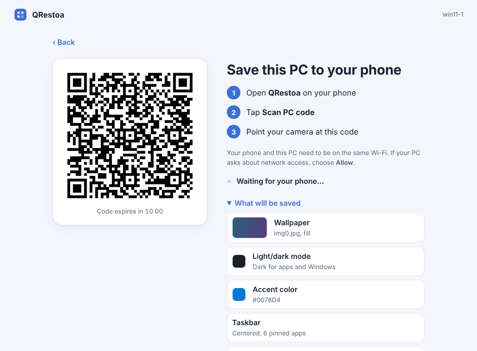
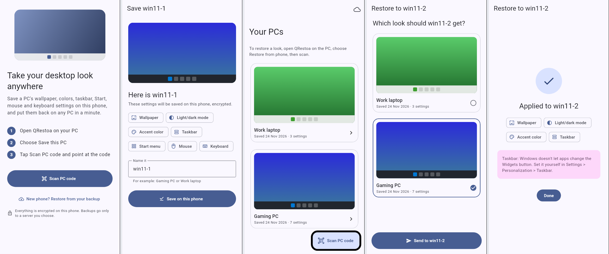

# QRPersonafy

Restore your desktop look on a fresh install by scanning a QR code with your phone, on
Windows or Linux.

QRPersonafy saves your **wallpaper, light/dark mode, accent color, taskbar and Start layouts,
and mouse and keyboard settings** to your phone, and puts them back on any Windows 10 or 11 PC
or Linux desktop in a minute. A PC saved on Windows can be restored on Linux and the other way
round. No Microsoft account and no vendor cloud: your settings live on your phone,
encrypted, with optional backup to a server you run yourself.

## Get it

Download from the [latest release](https://github.com/Slackpartistic/QRPersonafy/releases/latest):

- **Windows:** `QRPersonafy-Setup-<version>.exe`. Installs for your user, no admin needed.
  A portable zip is there too.
- **Linux (any distribution):** `QRPersonafy-<version>-x86_64.AppImage`. Make it executable
  (right-click → Properties → *Allow executing as program*, or `chmod +x`) and double-click it.
  A `.tar.gz` with an `install.sh` that adds it to your app menu is there too. Works with
  GNOME, KDE Plasma, Cinnamon, MATE and Xfce; see [what's supported](docs/linux.md).
- **Android:** `QRPersonafy-<version>.apk`. Allow installing from your browser or file
  manager when Android asks. (iOS is not available yet.)

Windows or Android may warn you before installing. That's expected for a small project that
isn't in an app store yet: see [Seeing a warning?](#seeing-a-warning) below.

## Seeing a warning?

QRPersonafy is free and open source, and every release file is built from this repository by
[GitHub Actions](.github/workflows/release.yml), in public. The warnings below appear because the
files aren't yet signed by a company that Windows or Google already knows, not because anything
harmful was found in them.

**Windows: "Windows protected your PC" (SmartScreen).** Windows shows this for any download it
hasn't seen many times before. Choose **More info**, check the app name says
`QRPersonafy-Setup-<version>.exe`, then choose **Run anyway**. If you use the portable zip and
Windows blocks it, right-click the zip, choose **Properties**, tick **Unblock**, and press
**OK** before extracting it.

**Android: "For your security, your phone is not allowed to install unknown apps."** Android
asks this the first time you install an app from outside the Play Store. Tap **Settings**, turn
on **Allow from this source** for your browser or file manager, and go back.

**Android: "Unsafe app blocked" or "App scan recommended" (Play Protect).** Google shows this
for apps it hasn't seen in the Play Store. Tap **More details → Install anyway** (or **Scan app**,
then **Install**).

**Want to check the file first?** Every release has a `SHA256SUMS.txt`. Compare the file's
checksum with the one listed there: on Windows, run `Get-FileHash QRPersonafy-Setup-<version>.exe`
in PowerShell; on Linux or macOS, run `sha256sum -c SHA256SUMS.txt --ignore-missing` in the
download folder. If they match, the file is exactly what GitHub built.

Only download QRPersonafy from [this repository's Releases page](https://github.com/Slackpartistic/QRPersonafy/releases).
We're working on signing the Windows app and publishing the phone app to Google Play, so these
warnings go away ([how](docs/signing.md), [code signing policy](docs/code-signing-policy.md)).

## Use it

**Save a PC:** open QRPersonafy on the PC and choose **Save this PC**. On the phone, tap
**Scan PC code**, scan, name it, save.

**Restore on another PC:** open QRPersonafy there and choose **Restore from phone**. Scan,
pick a saved PC, tap **Send**, then check what will change and choose **Apply to this PC**.
Your previous settings are backed up first, so **Undo** puts them back.

The phone and PC need to be on the same Wi-Fi. Allow QRPersonafy through Windows Firewall
on private networks when asked. On Linux, most desktop distributions let it through already;
if yours runs a firewall that blocks incoming connections, see [docs/linux.md](docs/linux.md).

**Back up the phone (optional):** tap the cloud icon in the phone app and connect it to
Nextcloud or your own [backup server](backup-server/README.md). Keep the recovery code it
shows; with it, a new phone gets all your PCs back.

## Privacy and security

- Transfers between PC and phone are end-to-end encrypted with a one-time key from the QR
  code ([protocol](docs/pairing-protocol.md)).
- Saved PCs are encrypted on the phone with a key in Android's secure storage.
- Backups are encrypted on the phone before upload; the server never sees your settings
  ([format](docs/backup.md)).
- Profiles are treated as untrusted: the desktop app only writes the specific settings it
  knows about, never arbitrary registry keys or files.

## Components

- **Desktop app** (Python, HTML/CSS UI): reads and applies Windows and Linux settings. [desktop/](desktop/README.md)
- **Phone app** (Flutter): keeps saved PCs and pairs with the PC by QR code. [mobile/](mobile/README.md)
- **Backup server** (optional, Docker): end-to-end encrypted backups. [backup-server/](backup-server/README.md)

How releases are built: [docs/releasing.md](docs/releasing.md). Roadmap: [PLAN.md](PLAN.md).

## Contributing

Issues and pull requests are welcome. Each part's README explains how to run its tests.

## License

[MIT](LICENSE)
